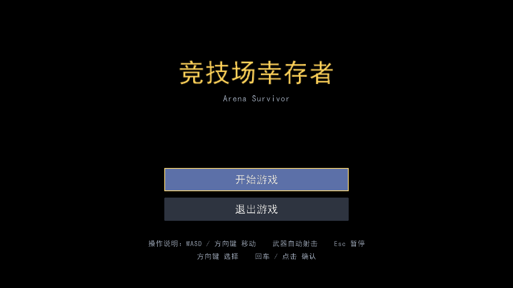
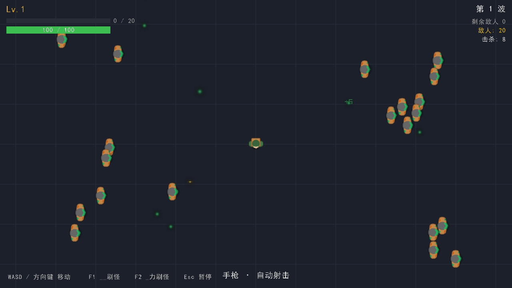
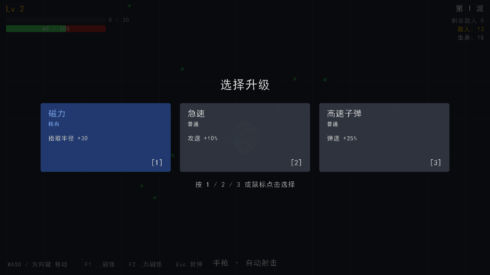
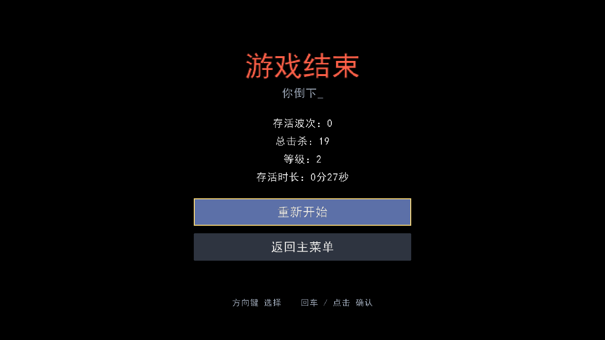

# 竞技场幸存者（Arena Survivor）

> **一次 AI 编程范式的探索实验：本仓库全部代码 100% 由 AI（Coding Agent）编写，人类不直接写任何一行代码。**

俯视角竞技场生存射击游戏（Roguelite 随机成长 + 自动战斗），玩法参考《土豆兄弟》《Hall of Torment》。C++ / raylib 实现。

## 为什么有这个仓库：AI 编程原则范式探索

本项目不是为了"用 AI 快点糊一个游戏"，而是验证一条可复用的 **AI 编程工作范式**：

> **约束先行，代码后至。** 先让 AI 产出完整的需求分析与系统设计作为"硬约束"，再让 AI 在这套约束的边界内逐任务编写代码。

具体流程（全部产物收录在 [docs/](docs) 与 [全流程AI提示词_竞技场生存射击游戏.md](全流程AI提示词_竞技场生存射击游戏.md)）：

```
阶段一：立约束（AI 输出文档，人类评审确认）
  01_需求分析   → 02_系统分析 → 03_系统设计 → 04_开发计划 → 05_平衡性说明
       ↓ 约束一旦确定，后续编码不得违反
阶段二：约束内编码（AI 按任务序列实现，T1 → T12）
  骨架 → 玩家 → 敌人 → 武器 → 碰撞 → HUD → 升级 → 波次 → 数值 → 流程 → 打磨 → 美术
```

实践中沉淀的几条原则：

- **文档即约束，约束即上下文**：每轮编码对话都把相关设计文档喂回给 AI，防止"写着写着就跑偏"。
- **任务切片要小且可验收**：每个 T 任务有明确的完成标准（如 T11 要求同屏 200 敌人帧率达标），AI 完成后立即验证。
- **数值集中收口**：所有平衡性参数集中在 [src/constants.h](src/constants.h)，改数值不改逻辑，AI 调参不会破坏架构。
- **AI 也会犯低级错误**：如 T8 阶段 AI 写出超出 `GetRandomValue` 上限的随机数（100000 > 32767），由测试暴露后修复（见提交 `T8fix`）——**人类评审与实测仍是闭环的必要环节**。
- **资产同样可追溯**：美术资源全部来自 CC0 授权素材（见下文），AI 负责替换与接入，授权文件随库归档。

如果你对"怎么和 AI 一起写软件"感兴趣，[全流程AI提示词_竞技场生存射击游戏.md](全流程AI提示词_竞技场生存射击游戏.md) 记录了从需求到成品的完整提示词与交互过程。

## 玩法介绍

- 你在 3200×1800 的竞技场中操纵角色移动，武器**自动索敌开火**，无需瞄准。
- 敌人以**波次**进攻：第 n 波 8 + 4×(n-1) 只，生命倍率 1 + 0.25×(n-1)；第 5 波起混入远程**喷吐者**，第 8 波起混入精英**蛮牛**（蓄力冲锋）。
- 击杀敌人掉落**经验点**，走近自动吸取；升级时**三选一**抽取随机词条（属性强化 / 新武器 / 特殊效果），构筑自己的 Build。
- 生命归零进入结算：查看本局统计（存活波次 / 总击杀 / 等级 / 存活时长），可重新开始或返回主菜单。

## 游戏截图

| 主菜单 | 战斗 |
|---|---|
|  |  |

| 升级三选一 | 结算 |
|---|---|
|  |  |

## 操作说明

| 按键 | 功能 |
|---|---|
| W / S / A / D 或 方向键 | 八方向移动 |
| Esc | 暂停 / 继续 |
| 1 / 2 / 3 | 升级三选一选择卡片 |
| ↑↓ / W S + 回车 | 菜单选择（暂停 / 结算界面；鼠标悬停 + 左键亦可） |
| F1 | 调试：刷 10 只爬行者 |
| F2 | 性能压力：刷 200 只（同屏 200 敌人验证帧率） |

窗口可任意缩放，画面保持 16:9 等比缩放（多余部分黑边）。

## 环境要求

- Windows 10/11
- Visual Studio 2022（含"使用 C++ 的桌面开发"工作负载，自带 CMake 3.28）
- Git
- vcpkg（manifest 模式；本仓库默认假设克隆在工作区 .vcpkg/）
- 依赖库：raylib 4.5（由 vcpkg.json 的 builtin-baseline 锁定版本）

## 如何编译运行（PowerShell）

1. 获取 vcpkg（仅首次）：

   ```powershell
   git clone --depth 1 https://github.com/microsoft/vcpkg .vcpkg
   .\.vcpkg\bootstrap-vcpkg.bat
   ```

   > 注：vcpkg.json 使用浅克隆 HEAD 作为 builtin-baseline，并通过 overrides 将 raylib 锁定为 4.5.0（见 vcpkg.json），无需补齐完整历史。

2. 配置构建目录（首次会自动通过 vcpkg 下载并编译 raylib，需几分钟）：

   ```powershell
   cmake -B build -S . -DCMAKE_TOOLCHAIN_FILE="$PWD\.vcpkg\scripts\buildsystems\vcpkg.cmake"
   ```

   vcpkg 装在其他位置的，把路径换成 `<你的vcpkg目录>\scripts\buildsystems\vcpkg.cmake`；cmake 不在 PATH 时可使用 VS 自带：

   ```powershell
   & "C:\Program Files\Microsoft Visual Studio\2022\Enterprise\Common7\IDE\CommonExtensions\Microsoft\CMake\CMake\bin\cmake.exe" -B build -S . -DCMAKE_TOOLCHAIN_FILE="$PWD\.vcpkg\scripts\buildsystems\vcpkg.cmake"
   ```

3. 编译：

   ```powershell
   cmake --build build --config Release
   ```

4. 运行：

   ```powershell
   .\build\Release\arena_survivor.exe
   ```

## 目录结构

```
docs/         约束文档：需求分析、系统分析、系统设计、平衡性说明、开发计划
src/          全部源代码（均由 AI 编写，清单见下）
assets/       游戏资源：sprites/ 美术贴图、LICENSE_*.txt 资源授权声明
screenshots/  游戏截图
全流程AI提示词_竞技场生存射击游戏.md   完整的 AI 交互提示词记录
README.md     本文件
```

## 美术资源

游戏内全部角色 / 敌人 / 弹丸 / 经验宝石 / 飞刃贴图来自 [Kenney.nl](https://kenney.nl/) 的免费素材包（均 **CC0 公共领域授权**，可免费商用），版权声明见 `assets/LICENSE_*.txt`。贴图经 [src/assets.cpp](src/assets.cpp) 惰性加载并统一绘制，仅在 `assets/sprites/` 保留本项目使用的 8 张贴图。

## src/ 文件清单（与 docs/03_系统设计.md §1.1 一致）

| 文件 | 归属模块 | 一句话职责 |
|---|---|---|
| main.cpp | 入口 | 创建 GameEngine 并进入主循环 |
| assets.h / assets.cpp | 素材 | 贴图惰性加载缓存与统一绘制、退出释放 |
| constants.h | 全局常量 | 数值基线集中定义（分模块命名空间） |
| game.h / game.cpp | 引擎核心 | GameEngine：状态机、固定时间步主循环、碰撞编排、性能日志 |
| player.h / player.cpp | 玩家 | 移动/受击/无敌帧/击退，持有武器与 Stats |
| stats.h / stats.cpp | 属性 | 属性字典，词条统一修改点 |
| weapon.h / weapon.cpp | 武器基座 | 抽象基类：索敌、射速计时、工厂注册 |
| weapon_pistol.h / .cpp | 武器 | 手枪（单发） |
| weapon_shotgun.h / .cpp | 武器 | 霰弹枪（扇形散射） |
| weapon_orbital.h / .cpp | 武器 | 环绕飞刃（持续旋转伤害） |
| projectile.h / projectile.cpp | 弹药 | 子弹与敌方弹体（含阵营标志） |
| enemy.h / enemy.cpp | 敌人基座 | 抽象基类：通用状态、受击闪白、接触攻击框架 |
| enemy_crawler.h / .cpp | 敌人 | 爬行者（追踪 + 分离力） |
| enemy_spitter.h / .cpp | 敌人 | 喷吐者（保持距离射击） |
| enemy_brute.h / .cpp | 敌人 | 蛮牛（蓄力冲锋状态机，精英） |
| wave_manager.h / .cpp | 波次 | 波次状态机与数量曲线 |
| enemy_spawner.h / .cpp | 生成 | 出生位置计算与敌人构造 |
| upgrade_system.h / .cpp | 升级 | 经验/等级/三选一/词条应用 |
| affix_library.h / .cpp | 词条 | 词条结构 + 词条池定义 |
| collision.h / collision.cpp | 碰撞 | 空间哈希网格 + 圆-圆检测（性能优化落地） |
| effects.h / effects.cpp | 打击感 | 命中/击杀粒子、击杀飘字、屏幕震动 |
| audio.h / audio.cpp | 音效 | 程序合成音效：射击/命中/击杀/升级/死亡 |
| ui.h / ui.cpp | 界面 | HUD、三选一面板、菜单与结算 |
| arena.h / arena.cpp | 场景 | 竞技场尺寸/围墙与边界钳制 |
| xp_orb.h / xp_orb.cpp | 掉落 | 经验点实体（运动、吸取） |

## 开发进度

- [x] T1 项目骨架：环境、窗口、固定时间步主循环、五状态空壳
- [x] T2 玩家移动与竞技场
- [x] T3 敌人基础与怪物 AI
- [x] T4 武器系统与自动攻击
- [x] T5 碰撞检测与伤害
- [x] T6 HUD 界面
- [x] T7 升级与随机词条
- [x] T8 波次系统与敌人多样化
- [x] T9 数值平衡与内容扩展
- [x] T10 完整游戏流程
- [x] T11 打磨与优化：空间哈希碰撞、打击感、程序生成音效、性能日志
- [x] T12 美术资源替换：CC0 贴图替代几何绘制

## License

代码部分以学习/研究目的公开；美术资源遵循各自 CC0 授权（见 `assets/LICENSE_*.txt`）。
