# 《竞技场幸存者》需求分析文档

| 项目 | 内容 |
|---|---|
| 文档编号 | 01 |
| 版本 | v1.0 |
| 项目名称 | 竞技场幸存者（Arena Survivor） |
| 文档性质 | 课程大作业 · Coding Agent 开发流程之需求分析产物 |

---

## 1. 项目概述

### 1.1 项目定位

《竞技场幸存者》是一款俯视角 2D 竞技场生存射击游戏，融合 Roguelite 随机生成机制与自动战斗（割草）玩法，玩法参考《土豆兄弟》（Brotato）与《Hall of Torment》。

### 1.2 核心玩法循环

> 波次生成敌人 → 玩家键盘移动走位规避 → 武器自动瞄准攻击 → 击杀敌人获得经验 → 升级时随机三选一（装备 / 属性增益）动态构建本局能力 → 存活尽可能多波次。

### 1.3 玩家目标

在不断增强的敌人波次中存活，通过随机升级选项构筑本局独一无二的战斗能力组合，冲击更高波次与击杀纪录。

---

## 2. 顶层玩法细化

### 2.1 视角与场景

- 俯视角 2D 竞技场，场地外有封闭围墙边界；
- 摄像机跟随玩家，角色始终位于画面中心附近；
- 竞技场尺寸约 3200×1800 像素（大于屏幕，需摄像机跟随），玩家生成于场地中心。

### 2.2 波次玩法结构

- 游戏自第 1 波开始，敌人按波次设计曲线分批生成；
- 波次越高：敌人数量越多、属性越强，并逐步引入新敌人种类（第 5 波起远程敌人、第 8 波起精英敌人）；
- 每波敌人全灭后进入短暂休整倒计时，再开始下一波；
- 随机性体现：同波次内敌人种类构成比例在一定范围内随机浮动。

### 2.3 玩家操作

- 输入：WASD 或方向键，八方向移动（对角移动速度归一化，不产生额外加速）；
- 除移动与菜单选择外，玩家无需进行任何攻击操作——武器全自动攻击。

### 2.4 武器自动攻击

- 武器自动锁定"射程内距离最近"的敌人开火；
- 初始武器为手枪；本局内可通过升级选项获得霰弹枪、环绕飞刃等新武器，武器可叠加共存。

### 2.5 经验与升级

- 敌人被击杀后掉落经验，靠近自动拾取；
- 经验条攒满升 1 级，溢出经验保留至下一级；
- 升级瞬间游戏暂停，弹出随机 3 个选项（属性增益 / 新装备）；
- 玩家三选一后立即生效并继续游戏。

### 2.6 死亡与结算

- 玩家 HP 归零即游戏结束；
- 结算界面显示本局统计：存活波次、击杀数、等级（及存活时长）；
- 可从结算界面直接重新开始，或返回主菜单。

### 2.7 Roguelite 随机性

- 局内随机：升级选项每级随机抽取、波次敌人构成随机；
- 目的：保证每一局体验差异，提升重玩价值。

---

## 3. 功能需求列表

> 编号规则 FR-xx；每条含用户故事与验收要点。

### FR-01 主菜单与开始游戏

- **用户故事**：作为玩家，我希望启动游戏后看到主菜单并选择开始，以便进入游戏。
- **验收要点**：
  1. 启动后显示主菜单（标题、开始、退出）；
  2. 选择"开始"后进入第 1 波战斗场景，且本局数据全部重置为初始状态；
  3. 主菜单可退出游戏。

### FR-02 玩家移动

- **用户故事**：作为玩家，我希望用 WASD/方向键控制角色八方向移动，以便走位规避敌人。
- **验收要点**：
  1. 八个方向均能移动，斜向速度与正向一致（归一化）；
  2. 移动平滑、镜头始终跟随角色位于画面中心附近。

### FR-03 竞技场边界限制

- **用户故事**：作为玩家，我希望角色移动被限制在竞技场内且被围墙物理阻挡，以便利用走位空间规避敌人。
- **验收要点**：
  1. 角色（含碰撞半径）无法越过围墙；
  2. 围墙清晰可见，与场地底色区分明显。

### FR-04 波次生成

- **用户故事**：作为玩家，我希望敌人按波次规律分批出现且波次间有休整，以便有节奏地规划战斗。
- **验收要点**：
  1. 第 1 波自动开始，敌人数量符合设计曲线；
  2. 每波敌人全灭后进入约 3 秒休整倒计时再开始下一波；
  3. 波次越高敌人数量与强度越高，第 5 波出现远程敌人、第 8 波出现精英敌人；
  4. 敌人出生点位于竞技场内且距玩家一定安全距离。

### FR-05 敌人行为（怪物 AI）

- **用户故事**：作为玩家，我希望不同敌人具有可辨识的行为差异，以便采取不同走位策略应对。
- **验收要点**（三种敌人）：
  1. 爬行者：持续追踪玩家，群体拥挤时保持一定分离；
  2. 喷吐者：与玩家保持安全距离，周期性发射可躲避的慢速弹体；
  3. 蛮牛（精英）：体型巨大，攻击前有蓄力预警，随后向玩家方向冲锋，冲锋有冷却。

### FR-06 武器自动攻击

- **用户故事**：作为玩家，我希望武器自动瞄准射程内最近的敌人开火，以便专注于走位。
- **验收要点**：
  1. 射程内有敌人时自动开火，无敌人时不开火；
  2. 锁定目标为射程内"最近"敌人；目标死亡后立即更换新目标；
  3. 不同武器开火模式不同（单发 / 扇形散射 / 环绕近身打击）。

### FR-07 伤害与死亡

- **用户故事**：作为玩家，我希望子弹命中敌人造成伤害、击杀后敌人消失，同时被敌人碰到会受伤，以便理解战斗反馈。
- **验收要点**：
  1. 子弹命中敌人按武器伤害扣血，敌人 HP 归零移除；
  2. 敌人接触玩家造成伤害，玩家受击后有无敌帧（约 0.6 秒，闪烁表现）与击退，避免连续掉血；
  3. 玩家 HP 归零进入结算流程。

### FR-08 经验获取与掉落

- **用户故事**：作为玩家，我希望击杀敌人掉落经验并自动拾取，以便推进升级。
- **验收要点**：
  1. 敌人死亡处掉落经验点，玩家靠近（拾取半径内）自动吸收入账；
  2. HUD 经验条实时更新；升级后溢出经验保留。

### FR-09 升级与三选一

- **用户故事**：作为玩家，我希望升级时游戏暂停并在 3 个随机强化中选择 1 个，以便构筑本局能力。
- **验收要点**：
  1. 升级瞬间游戏彻底暂停（敌人、子弹、移动全部冻结）；
  2. 弹出 3 个互不重复的随机选项，键盘（1/2/3）或鼠标可选；
  3. 选择后效果立即生效并恢复战斗；
  4. 选项按稀有度区分显示（普通/稀有/史诗不同配色）。

### FR-10 随机词条与装备

- **用户故事**：作为玩家，我希望随机选项包含属性增益与新装备（新武器），以便每局产生不同构筑路线。
- **验收要点**：
  1. 属性类词条（伤害、攻速、移速、最大生命、生命回复等）选择后立即反映到角色数值与战斗手感；
  2. 装备类词条选择后获得对应新武器（或强化已有装备），新武器即刻参与自动攻击；
  3. 每级抽取的 3 个选项不重复，稀有度权重符合设计（普通约 60% / 稀有约 30% / 史诗约 10%）。

### FR-11 暂停与继续

- **用户故事**：作为玩家，我希望随时暂停游戏，以便中断后继续或退出。
- **验收要点**：
  1. Esc 键暂停/继续切换；
  2. 暂停时画面静止并显示暂停菜单（继续 / 回主菜单 / 退出），键盘可选。

### FR-12 死亡结算与统计

- **用户故事**：作为玩家，我希望死亡后看到本局统计，以便了解成绩表现。
- **验收要点**：
  1. HP 归零后进入结算界面；
  2. 显示存活波次、总击杀数、等级、存活时长；
  3. 结算界面可重新开始或返回主菜单。

### FR-13 重新开始

- **用户故事**：作为玩家，我希望从结算界面一键重开新局，以便快速反复游玩。
- **验收要点**：
  1. 重开后所有本局数据彻底重置（第 1 波、1 级、初始手枪、满血）；
  2. 无上一局残留的敌人、子弹、经验点。

---

## 4. 非功能需求

| 编号 | 类别 | 要求 |
|---|---|---|
| NFR-01 | 性能 | 同屏敌人 200+ 时保持 60 FPS（碰撞检测需采用高效分区方案） |
| NFR-02 | 可扩展性 | 新增武器、词条、敌人类型时只增不改现有核心逻辑（面向对象多态设计） |
| NFR-03 | 可运行性 | 一条命令完成编译配置；生成 exe 双击即玩（Windows 10/11） |
| NFR-04 | 可维护性 | 代码可读、模块分明、关键逻辑中文注释、常量集中管理，禁止硬编码散落 |
| NFR-05 | 兼容性 | 目标平台 Windows；逻辑时间步固定，帧率波动不影响游戏逻辑 |

---

## 5. UML 用例图

> 参与者：玩家。用例覆盖 FR-01～FR-13 的主要玩家可感知功能。

```mermaid
graph TB
    P((玩家))

    subgraph AS["竞技场幸存者 游戏系统"]
        UC01[UC-01 开始游戏<br/>FR-01]
        UC02[UC-02 移动角色<br/>FR-02 FR-03]
        UC03[UC-03 进行波次战斗<br/>FR-04 FR-05]
        UC04[UC-04 武器自动攻击<br/>FR-06]
        UC05[UC-05 获得经验并升级<br/>FR-08 FR-09]
        UC06[UC-06 三选一抽取强化<br/>FR-09 FR-10]
        UC07[UC-07 查看HUD战况<br/>FR-08]
        UC08[UC-08 暂停/继续游戏<br/>FR-11]
        UC09[UC-09 查看结算统计<br/>FR-12]
        UC10[UC-10 重新开始游戏<br/>FR-13]
        UC11[UC-11 退出游戏<br/>FR-01]
    end

    P --> UC01
    P --> UC02
    P --> UC08
    P --> UC09
    P --> UC10
    P --> UC11

    UC01 -->|"&lt;&lt;include&gt;&gt;"| UC03
    UC01 -->|"&lt;&lt;include&gt;&gt;"| UC02
    UC03 -->|"&lt;&lt;include&gt;&gt;"| UC04
    UC03 -->|"&lt;&lt;include&gt;&gt;"| UC05
    UC03 -->|"&lt;&lt;include&gt;&gt;"| UC07
    UC05 -->|"&lt;&lt;include&gt;&gt;"| UC06
    UC03 -.->|"&lt;&lt;extend&gt;&gt; 生命归零时"| UC09
    UC09 -->|"&lt;&lt;include&gt;&gt;"| UC10
```

**用例关系说明**：

- 开始游戏必然包含波次战斗、移动角色；
- 波次战斗包含武器自动攻击、获得经验并升级、HUD 战况显示；
- 升级必然包含三选一抽取强化（核心循环）；
- 玩家生命归零时，波次战斗扩展出查看结算统计；
- 结算统计包含重新开始，形成一局游戏的闭环。

---

## 6. 验收标准总表（最终整体验收用）

| 序号 | 功能点 | 如何操作 | 预期现象 | 对应需求 |
|---|---|---|---|---|
| 1 | 启动与主菜单 | 双击 exe | 出现主菜单，可开始/退出 | FR-01 |
| 2 | 开始游戏 | 选择"开始" | 进入第 1 波，玩家立于场地中心，镜头居中 | FR-01/04 |
| 3 | 八方向移动 | 按 WASD/方向键（含对角） | 角色平滑移动，斜向速度无异感 | FR-02 |
| 4 | 边界限制 | 朝围墙移动 | 角色贴墙停止，无法越界或嵌入墙体 | FR-03 |
| 5 | 波次推进 | 击杀当前波全部敌人 | 进入约 3 秒休整倒计时后开始下一波 | FR-04 |
| 6 | 爬行者 AI | 第 1 波观察 | 持续追踪玩家，群聚时保持分散不叠点 | FR-05 |
| 7 | 喷吐者 AI | 存活至第 5 波 | 与之保持距离并发射可躲避的慢速弹体 | FR-05 |
| 8 | 蛮牛 AI | 存活至第 8 波 | 体型大、冲锋前有明显的蓄力变红预警 | FR-05 |
| 9 | 自动攻击 | 站定不按键，附近有敌人 | 武器自动朝最近敌人连续开火 | FR-06 |
| 10 | 伤害与击杀 | 观察子弹命中敌人 | 敌人掉血，HP 归零死亡消失 | FR-07 |
| 11 | 玩家受击 | 让敌人碰到角色 | 掉血、闪烁无敌约 0.6 秒、伴随击退 | FR-07 |
| 12 | 经验拾取 | 靠近击杀掉落物 | 掉落物被自动吸入，HUD 经验条增长 | FR-08 |
| 13 | 升级三选一 | 经验满触发升级 | 游戏暂停弹出 3 个随机选项，稀有度配色不同 | FR-09 |
| 14 | 词条生效 | 选择"+15% 伤害"等选项 | 关闭面板后战斗数值/手感立即变化 | FR-10 |
| 15 | 获得新装备 | 选择"霰弹枪"等装备选项 | 新武器立即加入自动攻击序列 | FR-10 |
| 16 | 暂停 | 战斗中按 Esc | 画面静止并弹出暂停菜单；再按继续 | FR-11 |
| 17 | 死亡结算 | HP 归零 | 进入结算界面，显示波次/击杀/等级/时长 | FR-12 |
| 18 | 重新开始 | 结算界面选"重新开始" | 第 1 波全新开局，无任何上一局残留 | FR-13 |
| 19 | 性能压力 | 高波次约 200+ 敌人同屏 | 保持 60 FPS，无卡顿掉帧 | NFR-01 |

---

## 7. 需求变更记录

| 版本 | 日期 | 变更内容 |
|---|---|---|
| v1.0 | 2026-10-17 | 初版，依据开发者给定需求规格细化形成 |