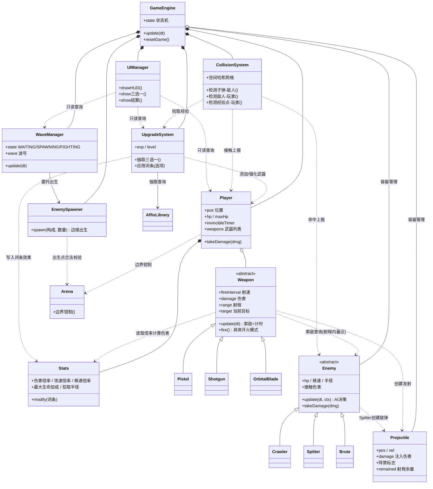
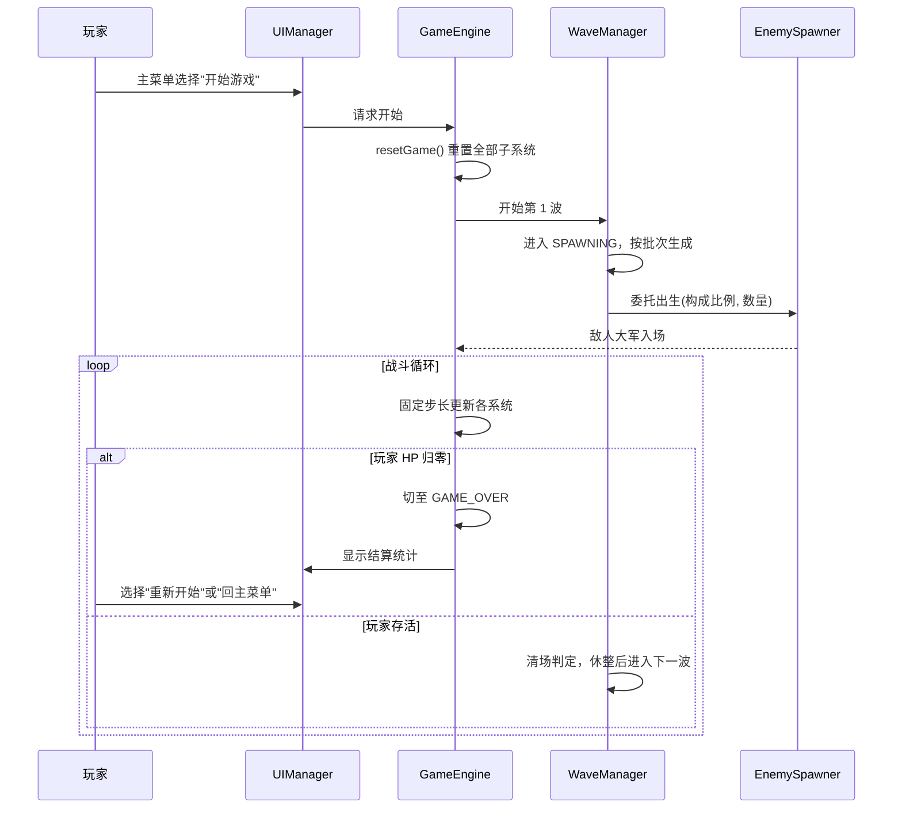
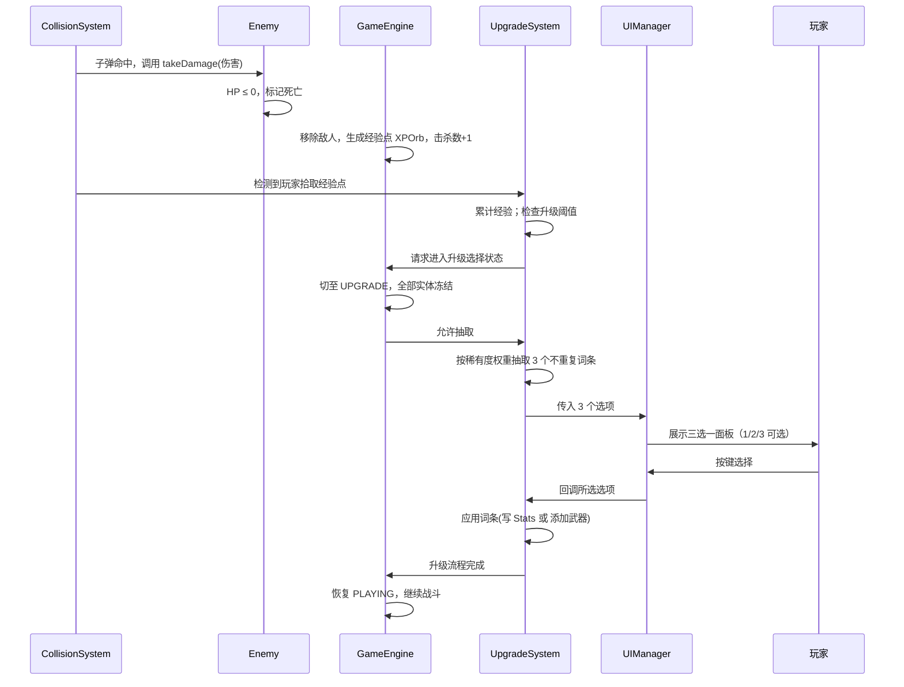
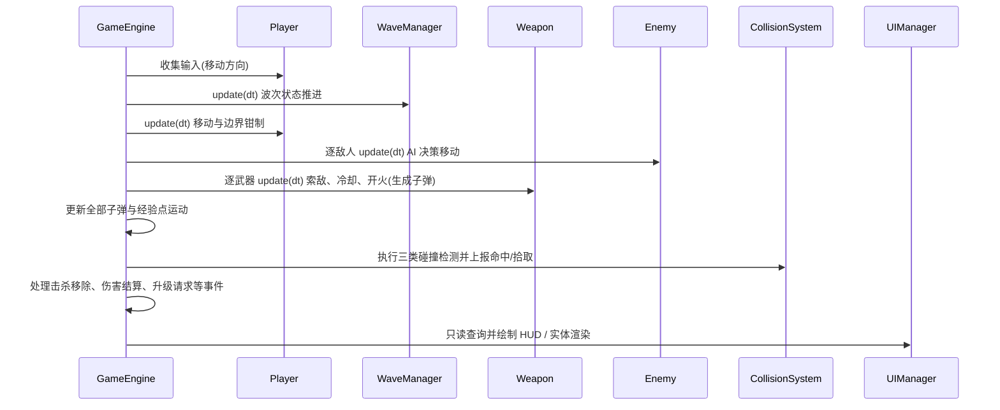

# 《竞技场幸存者》系统分析文档

| 项目 | 内容 |
|---|---|
| 文档编号 | 02 |
| 版本 | v1.0 |
| 依据 | docs/01_需求分析.md v1.0 |
| 文档性质 | 课程大作业 · 系统分析（对象识别、职责划分、对象间关系） |

---

## 1. 分析目标与方法

- **目标**：将需求分析中的功能点映射为游戏世界中的"对象"，明确每个对象的职责边界（管什么、不管什么），为系统设计（类接口）提供依据。
- **原则**：高内聚、低耦合、单一职责；每个对象只做与自己身份相符的事，凡不属于自身职责的行为一律委托或上报，不在对象内部越权处理全局事务。

---

## 2. 游戏世界对象模型

> 每类对象给出「职责（管什么）」「不管什么」两段描述，以及职责划分的关键理由。

### 2.1 Player —— 玩家角色

- **管什么**：
  - 自身状态：位置、碰撞半径、当前生命/最大生命、移速、无敌帧计时器、受击击退速度；
  - 移动输入处理（WASD/方向键八方向，对角归一化）；
  - 持有武器列表（本局获得的全部武器）；
  - 受击接口 `takeDamage(amount)`、击退接口 `applyKnockback(dir, force)`；无敌帧判定由 Player 自身维护。
- **不管什么**：
  - 武器何时开火、瞄准谁（Weapon 管）；
  - 敌人如何思考与行动（Enemy 各子类管）；
  - 经验、升级、词条的逻辑（UpgradeSystem 管）；Player 只暴露"可被 Stats 影响的属性"。
- **关键理由**：玩家是"被系统服务的实体"，而非总控制器。把攻击决策剥离给 Weapon、成长剥离给 UpgradeSystem，Player 才能保持纯粹的"移动 + 受击"语义。

### 2.2 Weapon（抽象基类）及具体武器

- **职责（抽象基类层）**：
  - 自动索敌：在射程内选择"距离玩家最近"的敌人作为当前目标（目标死亡/离开射程后自动更换）；
  - 攻速控制：按 `fireInterval` 计时，到点才允许开火；
  - 伤害基线：持有基础伤害值；开火时结合 Stats 计算最终伤害并写入子弹；
  - 仅定义两个虚扩展点：`update(dt, ...)`（持续型武器的行为覆写点）与发射型武器的 `fire(...)`（具体开火模式）。
- **职责（子类层）**：
  - 手枪：单发直线子弹；
  - 霰弹枪：短射程扇形散射多发子弹；
  - 环绕飞刃：无开火动作，覆写 `update` 维持围绕玩家旋转的刃体并周期性结算接触伤害。
- **不管什么**：子弹飞行、命中判定（Projectile/CollisionSystem 管）；武器列表的增删（UpgradeSystem/Player 管）。
- **「自动攻击决策归属」结论与理由**：
  - **决策权归 Weapon 基类，独立索敌控制器不另设。**
  - 理由：三把武器的索敌规则完全相同（射程内最近敌人），是共性能力；开火模式才是差异。若独立出"索敌控制器"，每个武器都要与它沟通，增加耦合而收益为零。将该逻辑封装在 Weapon 基类：新增武器只需实现"如何发射/如何持续作用"，不用重复实现"打谁、何时打"。

### 2.3 Projectile —— 子弹

- **管什么**：
  - 飞行：位置、速度、方向、已飞行距离（超出射程自动失效）；
  - 命中数据：伤害值、碰撞半径、阵营标志（玩家方 / 敌方，避免误伤自我阵营）；
  - 生命周期自检：出射程/出界/命中后自标记"待移除"。
- **不管什么**：
  - 谁发射了它（由创建者注入参数即可）；
  - 命中造成多少伤害的结算逻辑（伤害是创建时注入的数值，结算由 CollisionSystem 触发受击方的 takeDamage）；
  - 穿透等特殊词条（属于开火时构造方式差异，如穿透可在 T9 由"命中后不减亡"标志实现，本版本先按单次命中设计，为扩展预留标志位）。
- **关键理由**：子弹是纯数据载体 + 简单运动体，最容易保持无副作用，也最方便后续加"穿透""弹射"等词条。

### 2.4 Enemy（抽象基类）及三种具体敌人

- **职责（基类）**：
  - 通用状态：位置、半径、生命、移速、接触伤害、攻击冷却计时；
  - 通用接口：`update(dt, world 上下文)`（内部调用各子类的 AI 决策）、`takeDamage()`、伤害后的死亡标记；
  - 与玩家接触攻击的统一冷却框架（"碰到就掉血"对近战型通用）。
- **职责（子类，差异化 AI 即本项目的核心难点之一）**：
  - **Crawler 爬行者（近战追踪型）**：朝玩家直线追踪；同族过近时施加分离力，避免叠成一个点；
  - **Spitter 喷吐者（远程放风筝型）**：与玩家保持 300~600 距离（太近后退、太远接近）；每 2 秒发射 1 枚慢速敌弹（弹速约 180，可被走位躲避）；
  - **Brute 蛮牛（精英冲锋型）**：体型×2；0.8 秒蓄力预警（变色可读）→ 1 秒高速冲锋（移速×3）→ 5 秒冷却，循环往复。
- **不管什么**：何时出生、在哪出生（EnemySpawner 管）；波次推进（WaveManager 管）；经验掉落是否触发（死亡信号由敌人标记，掉落物由击杀流程生成）。
- **关键理由**：三种敌人共用"生命/移动/受击"语义，仅"每帧如何决策移动"不同——用虚函数覆写 AI 决策，正是 NFR-02"新增敌人只增不改"的落点。

### 2.5 WaveManager —— 波次管理器

- **管什么**：
  - 波次状态机：`WAITING`（休整倒计时，约 3 秒）→ `SPAWNING`（按批次投放敌人）→ `FIGHTING`（等待清场）；
  - 波号计数与数量曲线（第 n 波数量 = 8 + 4×(n-1)）；
  - 清场判定：本波已全部投放且场上敌人数归零 → 回到 WAITING；
  - 向 GameEngine 报告当前波次信息（供 HUD/结算查询）。
- **不管什么**：敌人具体出生在哪、如何构造（EnemySpawner 管）；敌人 AI；场上敌人列表的维护（实体容器由 GameEngine 层管理，WaveManager 只读计数）。
- **关键理由**：波次是"时序/节奏"问题，出生是"空间/构造"问题，二者分离后，改刷怪曲线不影响出生规则，反之亦然。

### 2.6 EnemySpawner —— 敌人生成器

- **管什么**：
  - 出生位置计算：竞技场边缘内侧随机点，且距玩家 ≥ 400 px（避免骑脸出生）；
  - 按 WaveManager 给定的构成比例与数量构造敌人实例，并按波次倍率初始化其属性；
  - 返回本次生成的敌人列表交给实体容器。
- **不管什么**：什么时候刷、刷多少（WaveManager 管）；出生后敌人怎么动（Enemy 管）。
- **关键理由**：它是一台"敌人工厂"，输入"订单"（构成+数量），输出实例，无任何决策状态，天然可替换、可测试。

### 2.7 UpgradeSystem —— 升级与随机词条系统

- **管什么**：
  - 经验管理：收入经验、当前等级、升级阈值（升级所需 = 20 + 10×(等级-1)）、溢出保留；
  - 升级触发：经验达标时向 GameEngine 发起"请求进入升级选择状态"（暂停权在 GameEngine）；
  - 三选一抽取：按稀有度权重（普通 60%/稀有 30%/史诗 10%）从词条池抽取 3 个互不重复选项；
  - 词条应用：属性类词条 → 修改 Stats；装备类词条 → 为玩家添加/强化武器。
- **不管什么**：升级面板长什么样、怎么画（UIManager 管）；玩家怎么输入选择（UI 收集输入后回调 UpgradeSystem）；词条的数值效果如何作用到战斗（由 Stats 与武器在计算时读取，UpgradeSystem 只负责"写入"）。
- **关键理由**：这是 Roguelite 重玩性的核心 + 项目的核心难点之一（随机词条系统），将其独立成系统，词条池、权重、抽取、应用四件事内聚在一起；"效果如何生效"则推到 Stats 的读写接口上，实现上互不纠缠。

### 2.8 Stats —— 属性系统

- **管什么**：
  - 玩家全部可成长属性的唯一权威来源：伤害倍率、攻速倍率、移速倍率、最大生命加成、子弹速度倍率、拾取半径、生命回复、减伤等；
  - 统一的读写接口，供词条修改、供武器/玩家在计算实际数值时读取；
  - 约定"有效值 = 基础值 × 倍率（倍率类）"与"有效值 = 基础值 + 加成（加算类）"两大类规则的统一实现位置。
- **不管什么**：有哪些词条、如何抽取（UpgradeSystem 管）；各对象的基础值定义（各对象自身或 constants.h 管，Stats 只保存"修改量"）。
- **关键理由**：所有词条最终都收敛到"改 Stats"，武器与玩家都从 Stats 读取——词条系统与战斗系统之间唯一的耦合点就是这一个类，词条组合爆炸的复杂度被关在一个笼子里。

### 2.9 CollisionSystem —— 碰撞检测

- **管什么**：
  - 实体登记与空间分区（网格空间哈希），避免 200+ 敌人 × 全量子弹的 O(N×M) 遍历；
  - 三类检测（圆-圆，半径平方和比较免开方）：
    1. 子弹-敌人（玩家弹命中敌人 → 对敌人调用 takeDamage）；
    2. 敌人-玩家（接触 → 上报接触事件，由 Player 判定无敌帧、由 GameEngine 编排伤害）；
    3. 经验点-玩家（拾取半径内 → 通知 UpgradeSystem 收入经验）；
  - 命中后失效处理（子弹移除、敌弹移除）的本分执行。
- **不管什么**：伤害数值的平衡（数值来自注入）；无敌帧是否生效（Player 自有状态）；击杀之后掉落/升级流程（GameEngine 编排）。
- **关键理由**：碰撞只负责"谁碰到了谁"的几何事实，不负责"碰到之后怎么办"的业务后果——检测与结算分离，是性能（分区可替换）与可维护性（业务逻辑集中在引擎层）的双重保障。

### 2.10 GameEngine —— 游戏主循环与状态机

- **管什么**：
  - 主循环：固定时间步（1/60 s）累积式更新，渲染与逻辑分离；
  - 状态机 `MAIN_MENU / PLAYING / PAUSED / UPGRADE / GAME_OVER` 的转换与各状态的更新/渲染分流（升级与暂停状态下实体全部冻结）；
  - 组合持有全部子系统（Player、WaveManager、CollisionSystem、UpgradeSystem、UIManager、武器/敌人/子弹/经验点容器）；
  - 一帧更新顺序编排（见 4.3）；本局统计聚合（击杀数、波次、存活时长）；`resetGame()` 全量重置；
  - 各系统之间的"中间人"仲裁（如：玩家死亡 → 切 GAME_OVER → 通知 UI 展示结算）。
- **不管什么**：任何子系统的内部逻辑（只管调用正确顺序与状态门控）。
- **关键理由**：它是唯一的"指挥中心"，所有跨系统流程都由它编排，子系统之间不直接互相指挥，避免网状依赖。

### 2.11 UIManager —— 界面管理

- **管什么**：
  - HUD：血条、经验条、当前等级、波次/休整倒计时、击杀数、当前武器说明；
  - 面板：主菜单、暂停菜单、升级三选一面板、结算面板；
  - 输入路由：面板打开时把按键/鼠标映射为菜单选择并回调对应系统；
  - 屏幕空间绘制（不随摄像机移动），与 GameEngine 状态联动显示。
- **不管什么**：游戏逻辑计算；经验、波次等数据的权威值（全部只读查询各系统状态后展示）。
- **关键理由**：UI 依赖世界，世界不依赖 UI——UI 的任何改动都不可能破坏游戏逻辑，天然满足"逻辑独立、易替换表现层"。

### 2.12 补充对象（次要实体）

| 对象 | 一句话职责 |
|---|---|
| Arena（竞技场） | 场地矩形与围墙尺寸的权威定义 + 边界钳制函数（供 Player 与出生点计算共用） |
| XPOrb（经验点） | 敌人死亡处生成的小型拾取物：位置、经验值、被吸拾取后移除 |
| AffixLibrary（词条池） | 词条定义表（名称/描述/稀有度/效果函数指针），供 UpgradeSystem 抽取时查询；作为数据模块独立于逻辑 |

---

## 3. 对象关系（UML 类图）

**关键关系文字说明**：

1. **GameEngine 组合各子系统**（实心菱形）：子系统生命周期与引擎一致，引擎销毁时全部销毁；子系统之间互不持有，仅通过引擎编排协作。
2. **UpgradeSystem 依赖 Stats 施加词条效果**：词条应用 = 一次对 Stats 的写入；而 Weapon 在开火时"只读"Stats 计算伤害。写入方与读取方分离，词条效果即时生效且无需通知任何战斗对象。
3. **Weapon 与 Projectile 的关系**：武器在开火瞬间创建子弹（虚箭头依赖即"创建"],子弹放入 GameEngine 层容器统一管理（聚合），武器不持有子弹引用——子弹存活由容器与 CollisionSystem 决定。
4. **继承体系两棵树**：Weapon 树（手枪/霰弹/环绕飞刃）与 Enemy 树（爬行者/喷吐者/蛮牛），是 NFR-02"只增不改"的骨架。
5. **UIManager 只读依赖**：UI 与逻辑之间全部是单向只读依赖，UI 永不反向修改世界状态。

---

## 4. 关键流程（时序描述）

### 4.1 一局游戏的生命周期

### 4.2 击杀 → 经验 → 升级 → 三选一 → 应用词条（核心循环）

### 4.3 一帧游戏循环（PLAYING 状态下）

> 顺序说明：输入最先（决定玩家意图）→ 波次推进（可能投放新敌人）→ 玩家移动 → 敌人 AI → 武器开火 → 所有抛射体运动 → 碰撞检测与结算 → 渲染最后。碰撞永远在"所有移动完成之后、渲染之前"，保证画面所见即物理所得。

---

## 5. 职责边界检查（高内聚 / 低耦合自检）

| 检查项 | 结论 |
|---|---|
| 玩家知道敌人的 AI 细节吗？ | 不。玩家只感知"接触伤害上报"，由 Enemy 自行决策 |
| 武器知道子弹去哪了吗？ | 不。创建后由容器与碰撞系统管理，武器不留引用 |
| WaveManager 知道敌人在哪出生吗？ | 不。只下"订单"，出生点归 EnemySpawner |
| 碰撞系统知道伤害是多少、要不要无敌吗？ | 不。只上报几何事实，数值与状态归各对象 |
| UI 能修改游戏状态吗？ | 不。UI 只读查询，输入经回调交还系统处理 |
| 词条系统知道效果如何作用到战斗吗？ | 不。只写 Stats，战斗侧读取时自然生效 |
| 新增一把武器要改其他文件吗？ | 不。新增 Weapon 子类 + 注册名称即可（T9 验证） |
| 新增一种敌人要改刷怪器吗？ | 仅需在构成比例表登记，出生算法复用 |

---

## 6. 变更记录

| 版本 | 日期 | 变更内容 |
|---|---|---|
| v1.0 | 2026-10-17 | 初版：识别 12 类对象、绘制类图与 3 条关键时序流程 |