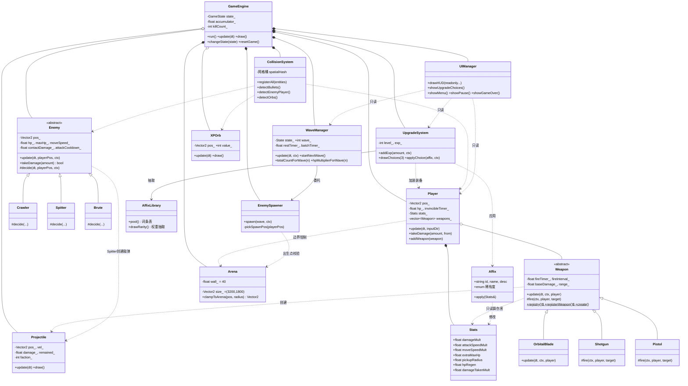

# 《竞技场幸存者》系统设计文档

| 项目 | 内容 |
|---|---|
| 文档编号 | 03 |
| 版本 | v1.0 |
| 依据 | docs/01_需求分析.md v1.0、docs/02_系统分析.md v1.0 |
| 文档性质 | 课程大作业 · 系统设计（模块、类接口、数值基线） |

---

## 1. 目录与文件规划

### 1.1 src/ 文件清单（按模块）

| 文件 | 归属模块 | 一句话职责 |
|---|---|---|
| main.cpp | 入口 | 创建窗口与 GameEngine，进入主循环 |
| constants.h | 全局常量 | 所有数值基线集中定义（分模块命名空间） |
| game.h / game.cpp | 引擎核心 | GameEngine：状态机、固定时间步主循环、子系统组合与事件编排、resetGame |
| player.h / player.cpp | 玩家 | Player 移动/受击/无敌帧/击退，持有武器与 Stats |
| stats.h / stats.cpp | 属性 | Stats 属性字典，词条统一修改点 |
| weapon.h / weapon.cpp | 武器基座 | Weapon 抽象基类：索敌、射速计时、工厂注册机制 |
| weapon_pistol.h/.cpp | 武器 | 手枪（单发） |
| weapon_shotgun.h/.cpp | 武器 | 霰弹枪（扇形散射） |
| weapon_orbital.h/.cpp | 武器 | 环绕飞刃（持续旋转伤害） |
| projectile.h / projectile.cpp | 弹药 | 子弹与敌方弹体（含阵营标志） |
| enemy.h / enemy.cpp | 敌人基座 | Enemy 抽象基类：通用状态、受击、攻击冷却框架 |
| enemy_crawler.h/.cpp | 敌人 | 爬行者（追踪 + 分离力） |
| enemy_spitter.h/.cpp | 敌人 | 喷吐者（保持距离放风筝射击） |
| enemy_brute.h/.cpp | 敌人 | 蛮牛（蓄力冲锋状态机） |
| wave_manager.h / wave_manager.cpp | 波次 | WaveManager 波次状态机与数量曲线 |
| enemy_spawner.h / enemy_spawner.cpp | 生成 | EnemySpawner 出生位置计算与敌人构造 |
| upgrade_system.h / upgrade_system.cpp | 升级 | UpgradeSystem：经验/等级/三选一/词条应用 |
| affix_library.h / affix_library.cpp | 词条 | Affix 结构 + 词条池定义表（数据模块） |
| collision.h / collision.cpp | 碰撞 | CollisionSystem 空间哈希网格 + 圆-圆检测与上报 |
| ui.h / ui.cpp | 界面 | UIManager：HUD、三选一面板、菜单与结算 |
| arena.h / arena.cpp | 场景 | 竞技场尺寸/围墙常量与边界钳制函数 |
| xp_orb.h / xp_orb.cpp | 掉落 | XPOrb 经验点实体（运动、吸取） |

> 全部源代码放 src/，无子目录（课程项目规模下扁平结构反而清晰）；`weapon_*`、`enemy_*` 系列即 NFR-02"只增不改"的物理落点——新内容 = 新文件，不改旧文件。

### 1.2 依赖方向（分层）

```
Layer0 基础层   constants.h  arena  stats          （无内部依赖）
Layer1 实体层   player  projectile  xp_orb  enemy*  （依赖 Layer0）
Layer2 行为层   weapon*  wave_manager  enemy_spawner
               upgrade_system  affix_library  collision   （依赖 Layer1）
Layer3 引擎层   game                                     （依赖 Layer0~2）
Layer4 表现层   ui                                       （只向下只读依赖）
```

- **UI 依赖游戏逻辑，游戏逻辑不依赖 UI**：game.h 对 UIManager 只做前向声明（`class UIManager;`），由 main.cpp 装配后传入；ui.cpp 可以包含各系统头文件做**只读查询**与绘制。任何 UI 文件被删除，游戏逻辑仍可完整编译运行。
- behavior 层对 engine 层零依赖：所有跨系统编排（如"玩家死亡→结算"）通过 GameEngine 完成。

---

## 2. 类接口设计（签名草案，C++20 风格）

> 仅接口草案不含实现。类型约定：`Vector2` 为 raylib 矢量；坐标为世界坐标；时间单位为秒。

### 2.1 Stats 属性系统

```cpp
// stats.h —— 全部可成长属性的唯一权威来源，词条统一的修改落点
struct Stats {
    // ---- 倍率类（与基础值相乘）----
    float damageMult      = 1.0f;   // 伤害倍率
    float attackSpeedMult = 1.0f;   // 攻速倍率（实际间隔 = 基础间隔 / 倍率）
    float moveSpeedMult   = 1.0f;   // 移速倍率（实际移速 = 基础移速 × 倍率）
    float bulletSpeedMult = 1.0f;   // 弹速倍率
    // ---- 加算类（与基础值相加）----
    float extraMaxHp      = 0.0f;   // 最大生命加成
    float pickupRadius    = 0.0f;   // 拾取半径加成（实际 = 基础半径 + 加成）
    float hpRegen         = 0.0f;   // 每秒生命回复
    // ---- 特殊类 ----
    float damageTakenMult = 1.0f;   // 受伤倍率（<1 即减伤）
    // ---- T9 武器机制类落点（docs/05 平衡自查引用）----
    int   penetrationExtra = 0;     // 子弹穿透数（穿甲弹 +1）
    float lifestealPct     = 0.0f;  // 吸血比例（造成伤害的 2% 回复生命）
    float bladeDamageBonus = 0.0f;  // 环绕飞刃加算伤害（飞刃强化 +5）
};
// 词条效果的统一形态（见 AffixLibrary）：std::function<void(Stats&)> apply;
```

### 2.2 Player 玩家

```cpp
// player.h
class Player {
public:
    void update(float dt, Vector2 inputDir);          // 移动 + 无敌帧/击退衰减
    void updateWeapons(float dt, GameContext& ctx);   // 逐武器索敌/冷却/开火
    void draw() const;                                 // 自绘（含无敌闪烁）
    void drawWeapons() const;                          // 持续型武器（环绕飞刃）自绘
    void takeDamage(float amount, Vector2 fromPos);   // 无敌帧内忽略；否则扣血并击退
    void heal(float amount);                           // 回血（上限截断）
    int  giveWeapon(const std::string& weaponId);
        // 装备词条实装（T9）：无则经 Weapon::create 创建、有则 upgradePick 升级伤害；
        // 返回 1=新获得 / 2=已有升级 / 0=无效注册名
    int  maxHp() const { return BaseMaxHp + (int)stats_.extraMaxHp; }
    float pickupRadius() const;
    // 查询接口（只读，供武器/UI/碰撞系统使用）
    const Vector2& pos() const;  float radius() const;
    const Stats& stats() const;  int hp() const;
private:
    Vector2 pos_;                       // 世界坐标
    float   hp_         = 100.0f;      // 当前生命
    Stats   stats_;                     // 属性中心（词条修改点）
    Vector2 knockbackVel_;              // 击退速度（受击瞬间赋值，逐帧衰减）
    float   invincibleTimer_ = 0.0f;    // 无敌帧计时（>0 时不受伤）
    std::vector<std::unique_ptr<Weapon>> weapons_;   // 本局武器列表
};
```

### 2.3 Weapon 武器基类与工厂注册（核心扩展点）

```cpp
// weapon.h —— 自动攻击决策（索敌）封装在基类；子类只实现"如何开火/如何持续作用"
struct GameContext; // 前向：武器可只读查询敌人列表、玩家、并请求生成子弹

class Weapon {
public:
    explicit Weapon(float fireInterval, float damage, float range);
    virtual ~Weapon() = default;

    // 非虚主流程：索敌(射程内最近敌人) → 冷却计时 → 到点开火；持续型武器可整体覆写
    virtual void update(float dt, GameContext& ctx, const Player& player);

    // ---- 类型信息（供 UI 展示与强化判重）----
    const std::string& typeId() const;   // 注册名，如 "shotgun"

    // ---- 展示信息（T6 HUD；std::string 支持飞刃刃数动态描述）----
    virtual std::string displayName() const { return typeId_; }
    virtual std::string description() const { return ""; }

    // ---- T9 扩展接口（默认实现均无害：新增武器零成本接入）----
    virtual void draw(const Player& player) const;  // 持续型武器自绘（默认不画）
    virtual void upgradePick();                     // 装备词条再选：伤害按武器差异化成长（+N）

    // ---- 工厂注册机制（新增武器只增不改的关键）----
    using Factory = std::function<std::unique_ptr<Weapon>(const Stats* stats)>;
    static std::unordered_map<std::string, Factory>& registry();
    static void registerWeapon(const std::string& id, Factory f);
    static std::unique_ptr<Weapon> create(const std::string& id, const Stats* stats);

protected:
    virtual void fire(GameContext& ctx, const Player& player,
                      const Vector2& targetPos);      // 发射型子类实现开火模式
    const Stats* stats_;            // 只读引用：伤害 = 基础伤害 × damageMult
    float fireTimer_    = 0.0f;     // 下次可开火时间倒计时
    float fireInterval_ = 0.5f;     // 基础攻击间隔
    float baseDamage_   = 10.0f;    // 基础伤害
    float range_        = 600.0f;   // 索敌射程
};

// weapon_pistol.cpp 注册示范（宏自行展开，此处为概念阐述）
// static bool registered = []{ Weapon::registerWeapon("pistol", ...); return true; }();
// 新增武器流程：新建 weapon_xxx.h/cpp 继承 Weapon → 覆写 fire() 或 update() → 注册名称
// → 词条池登记装备词条。全程不改 weapon.h 与旧武器文件。
```

**子类开火模式约定**：`Pistol` 覆写 `fire`（单发）；`Shotgun` 覆写 `fire`（5 发 25° 扇形散射）；`OrbitalBlade` 覆写整个 `update`（无"开火"语义，维持绕体旋转的刃体与周期接触伤害）。

### 2.4 Enemy 敌人基类

```cpp
// enemy.h —— 通用状态与受击框架在基类；AI 决策通过虚函数交由子类
class Enemy {
public:
    virtual ~Enemy() = default;
    bool takeDamage(float amount);       // 扣血并返回是否死亡
    bool isDead() const;

    // 非虚主调：先维护攻击冷却与状态计时，再调用子类 AI 决策
    void update(float dt, const Vector2& playerPos, GameContext& ctx);
    virtual void draw() const = 0;

    // 通用属性
    const Vector2& pos() const; float radius() const; float hp() const;
    float contactDamage() const;        // 接触伤害（近战/精英用）
    bool  attackCooldownReady(float dt); // 接触攻击冷却框架
    int   xpValue() const;               // 死亡经验掉落

protected:
    virtual void decide(float dt, const Vector2& playerPos, GameContext& ctx) = 0;
    Vector2 pos_; float radius_; float hp_; float maxHp_;
    float moveSpeed_; float contactDamage_; float attackCooldown_;
    // 受击闪白计时等表现状态可留于基类
};
```

子类 AI 差异（`decide` 覆写点）：

| 子类 | decide 行为 |
|---|---|
| Crawler | 朝玩家方向移动；同族间距离过近施加分离偏移 |
| Spitter | 与玩家距离 >600 接近 / <300 远离；射击冷却到点发射慢速敌弹（Projectile 带敌方阵营标志） |
| Brute | 状态机：追踪 → 蓄力 0.8s（变红）→ 冲锋 1s（速度×3）→ 冷却 5s，循环 |

### 2.5 WaveManager 波次管理器

```cpp
// wave_manager.h
class WaveManager {
public:
    enum class State { WAITING, SPAWNING, FIGHTING };
    void update(float dt, GameContext& ctx);   // 状态推进；到刷怪时机通过 ctx 委托生成
    void startNextWave();                       // WAITING 倒计时结束后进入
    void notifyEnemyDied();                     // FIGHTING 中清场判定用
    int  wave() const;                          // 当前波号（UI/结算只读）
    State state() const;   float restTimeLeft() const;
    int  totalCountForWave(int n) const;        // 数量曲线：8 + 4×(n-1)
    float hpMultiplierForWave(int n) const;     // 生命倍率：1 + 0.25×(n-1)
private:
    State state_ = State::WAITING;
    int wave_ = 1;             // 下一波波号
    float restTimer_ = 3.0f;   // 波间休整倒计时
    int spawnBatchLeft_ = 0;   // 本波剩余待投放数（分批双保险）
    float batchTimer_ = 0.0f;  // 批次间隔约 0.5s，避免一帧全刷
};
```

### 2.6 UpgradeSystem 升级与词条

```cpp
// upgrade_system.h
class UpgradeSystem {
public:
    void addExp(int amount, GameContext& ctx);   // 含"经验满级触发升级请求"判定
    int  level() const;  int expInLevel() const;
    int  expToNext() const { return 20 + 10 * (level_ - 1); }  // 升 L 级所需经验

    // 三选一抽取（升级状态内由 GameEngine 调用；ctx 供前置武器词条过滤）
    std::vector<Affix> drawChoices(int count, GameContext& ctx);   // 稀有度权重 + 互不重复
    int applyChoice(const Affix& affix, GameContext& ctx);
        // 属性类 → affix.apply(stats)；装备类 → player.giveWeapon(...)
        // 返回 1=新获得武器 / 2=已有升级 / 0=其余（供屏幕提示文案分支）
private:
    int level_ = 1;  int exp_ = 0;
};
```

### 2.7 GameEngine 状态机

```cpp
// game.h
class GameEngine {
public:
    enum class GameState { MAIN_MENU, PLAYING, PAUSED, UPGRADE, GAME_OVER };
    void run();                                  // 窗口与主循环入口
    void update(float dt);                       // 按状态分流
    void draw();                                 // 世界渲染（通过 Camera2D）+ 转交 UIManager
    void changeState(GameState next);            // 状态门控：唯一切换出口
    void resetGame();                            // 全量重置（开局/重开共用）
    // 只读统计（结算用）：波次/击杀/等级/存活时长
    // 容器：敌人、子弹(敌我)、经验点 统一在此管理；各系统经 GameContext 访问
private:
    GameState state_ = GameState::MAIN_MENU;
    float accumulator_ = 0.0f;                   // 固定步长 1/60 累积
    // 子系统：unique_ptr<Player/WaveManager/EnemySpawner/UpgradeSystem/
    //          CollisionSystem/UIManager/Arena> 及实体容器
    int killCount_ = 0; float survivalTime_ = 0.0f;
};
```

### 2.8 碰撞分区方案（空间哈希，先方案后实现）

- 竞技场 3200×1800 划分为 **160×160 的网格单元**（20×约11.25 格，取 21×12）；
- 每帧对**动态实体**（子弹、敌人、经验点）按中心点登记到网格桶（`unordered_map<格哈希, 桶列表>`）；玩家等移动慢的实体同样登记；静态围墙不参与（玩家用 Arena 钳制）。
- 查询"可能与 A 相撞的对象"时，只检查 A 所在格及相邻 8 格（3×3 邻域）：
  - 子弹-敌人：对每颗子弹查邻域内敌人（敌人登记格按其半径可能跨格，采用"按半径扩展的桶登记"）；
  - 敌人-玩家、经验点-玩家：对玩家查邻域。
- **复杂度收益**：朴素双循环最坏 O(200 × 300) ≈ 6 万比较/帧；分区后单实体平均只与所在邻域对象比较，整体可降到 O(实体数 × 邻域密度)（稀疏分布下近线性），满足 NFR-01。
- **渐进策略**：T5 先实现朴素检测保证正确性并用测试锁定行为 → T11 替换为空间哈希，用帧率与比较次数日志量化对比，作为报告"性能优化"素材。

---

## 3. UML 类图（核心类）



---

## 4. 数值设计基线表

> 原则：全部常量最终落到 constants.h（下表中的"基线"即 constants 初值）；T9 平衡调参时只改此表对应常量与本文档。

### 4.1 玩家

| 参数 | 基线值 | 推导思路 |
|---|---|---|
| 最大生命 | 100 | 爬行者接触伤害 8/次（0.8s 冷却），单只怪满血可承 12+ 次，容错充裕 |
| 移速 | 220 px/s | 爬行者 120 px/s：玩家直线甩开约 1.8 倍；开局逃生空间明确 |
| 碰撞半径 | 14 px | 视觉直径 28，与敌人同规格，公平的接触判定 |
| 受击无敌帧 | 0.6 s | 大于敌人接触攻击冷却 0.8s 的一半，避免被围殴时每帧掉血；小于冷却，保证被持续追击仍有压力 |
| 击退力度 | 240 | 受击后约 0.2~0.3s 内显著位移，形成"被拍开"手感但不失控 |
| 基础拾取半径 | 70 | 约为 5 倍玩家半径，击杀后需"走过去吸经验"而非全图吸，保留走位取舍 |
| 秒回默认 | 0 | 生命回复只能来自词条，保证资源稀缺性 |

### 4.2 武器（基础值 × Stats 倍率 = 实际值）

| 武器 | 射速(发/s) | 伤害 | 弹速 | 射程 | 特性 | 推导思路 |
|---|---|---|---|---|---|---|
| 手枪 | 2.4 | 10 | 600 | 900 | 单发，索敌最近敌人 | 开局 DPS=24；爬行者 20 HP 恰为两枪，1 级时约 0.8s 击杀一只，节奏适中 |
| 霰弹枪 | 0.8 | 12×5 | 500 | 500 | 25° 扇形 5 发 | 贴脸全中 DPS=48 为手枪 2 倍，但需近距离高风险，故单发略高、射速低 |
| 环绕飞刃 | — | 15/刃·0.5s | — | 90(旋转半径) | 2 刃绕体，1.8 rad/s | 被动近身威慑 DPS=60，但伤害范围受限于旋转半径，且不与射程词条联动，防止过强 |

### 4.3 敌人

| 敌人 | HP | 移速 | 半径 | 接触伤害 | 攻击冷却 | 经验 | 行为 | 首次出现 |
|---|---|---|---|---|---|---|---|---|
| 爬行者 | 20 | 120 | 14 | 8 | 0.8s | 5 | 追踪+分离力 | 第 1 波 |
| 喷吐者 | 30 | 100 | 14 | 6(弹体) | 弹体间隔 2s | 7 | 保持 300~600 距离射击（弹速 180） | 第 5 波 |
| 蛮牛(精英) | 20×30=600 | 120×0.7=84 | 28 | 8×3=24 | 冲锋冷却 5s | 5×10=50 | 蓄力 0.8s→冲锋 1s(×3)→冷却 | 第 8 波 |

- 喷吐者弹速 180 ≈ 玩家移速 0.8 倍：不跑会被打中、跑了就躲得开，"可躲避"是设计目标；
- 蛮牛冲锋速度 252 ≈ 玩家移速 1.15 倍：**跑不过**，必须预读蓄力预警横向闪避——体现"看得到威胁"的设计；冲锋 1s 内位移 252px，足够跨越半个屏幕制造压迫。

### 4.4 波次曲线与构成

| 公式 | 说明 |
|---|---|
| 数量 = 8 + 4×(n-1) | 第 1 波 8 只，每波 +4；第 10 波 44 只，约每 1.5 波翻一番 |
| 生命倍率 = 1 + 0.25×(n-1) | 第 10 波敌人 HP×3.25：目标是"数量涨→单体也硬"，逼迫玩家靠构筑而非纯操作 |
| 波间休整 3s | 每轮喘息与决策窗口，也用于画面上清理经验点 |

构成权重（同波次内随机浮动，体现 Roguelite 随机性）：

| 波次 | 爬行者 | 喷吐者 | 蛮牛 |
|---|---|---|---|
| 1~4 | 100% | — | — |
| 5~7 | 80% | 20% | — |
| 8+ | 70% | 22% | 8%（每波最多 2 只） |

### 4.5 经验与等级

| 项 | 公式/值 | 推导思路 |
|---|---|---|
| 升 L 级所需 | 20 + 10×(L-1) | 第 1 级 2 只半怪升一级，快速给玩家第一次正反馈；线性增长避免后期指数失控 |
| 溢出保留 | 是 | 大经验（精英 50 XP）不浪费，鼓励挑战精英 |
| 击杀掉落 | 见 4.3 经验列 | 精英 ×10，高风险高回报是冲层关键节奏 |

### 4.6 升级三选一与稀有度

| 稀有度 | 权重 | 展示色 | 说明 |
|---|---|---|---|
| 普通 | 60% | 白 | 稳定的小幅增益 |
| 稀有 | 30% | 蓝 | 明显变强或机制改变 |
| 史诗 | 10% | 紫 | 获取新武器为主，改变战斗方式 |

抽取规则：先按权重抽稀有度、再在该稀有度词条子池内抽具体词条（子池内等概率），3 个选项互不重复。

### 4.7 词条池 v2（17 项，T9 由 v1 的 11 项扩充）

| # | 词条 | 类型 | 稀有度 | 效果（对 Stats 的修改） |
|---|---|---|---|---|
| 1 | 伤害强化 +15% | 属性 | 普通 | damageMult ×1.15 |
| 2 | 急速 +10% | 属性 | 普通 | attackSpeedMult ×1.10 |
| 3 | 疾跑 +8% | 属性 | 普通 | moveSpeedMult ×1.08 |
| 4 | 强健 +20 生命 | 属性 | 普通 | extraMaxHp +20 且当前 HP 回复 20 |
| 5 | 高速子弹 +25% | 属性 | 普通 | bulletSpeedMult ×1.25 |
| 6 | 磁力 +30 | 属性 | 稀有 | pickupRadius +30 |
| 7 | 生命再生 +1/s | 属性 | 稀有 | hpRegen +1.0 |
| 8 | 韧性 受伤 -10% | 属性 | 稀有 | damageTakenMult ×0.9 |
| 9 | 吸血 2% | 属性(特殊) | 稀有 | lifestealPct +0.02：子弹/飞刃结算伤害的 2% 回复生命 |
| 10 | 飞刃强化 +5 | 属性(前置) | 稀有(需已有飞刃) | bladeDamageBonus +5：环绕飞刃单刃伤害 +5 |
| 11 | 神速 +25% | 属性 | 史诗 | attackSpeedMult ×1.25 |
| 12 | 铁甲 受伤 -20% | 属性 | 史诗 | damageTakenMult ×0.8 |
| 13 | 巨人 +40 生命 | 属性 | 史诗 | extraMaxHp +40 且当前 HP 回复 20 |
| 14 | 强磁力 +60 | 属性 | 史诗 | pickupRadius +60 |
| 15 | 穿甲弹 | 属性(特殊) | 史诗 | penetrationExtra +1：每颗子弹可穿过 1 个敌人（同一子弹对同一敌人不重复结算） |
| 16 | 霰弹枪 | 装备 | 史诗 | giveWeapon("shotgun")：无则获得武器；已有则每弹丸伤害 +3（5 发齐射 +15） |
| 17 | 环绕飞刃 | 装备 | 史诗 | giveWeapon("orbital")：无则获得武器；已有则单刃伤害 +4 |

- 倍率类词条可叠加时**相乘**（两个 +15% 伤害 = ×1.3225），与"增伤稀释"的常见设计反向——本项目鼓励堆叠构筑，T9 平衡自查重点盯"全堆伤害/攻速×穿透"是否过强（结论与调参见 docs/05）；
- #10 是"前置条件词条"模式：抽取前检查玩家是否已持有环绕飞刃，不满足则从候选池剔除（#9/#15 无前置，全武器通用）；
- 装备类 v1 曾写明"飞刃已有则刃数 +1"，v1.1 起与霰弹统一为"已有则伤害成长"；v1.2（T9 平衡修正，依据 docs/05 §4.1）进一步差异化升级增量：手枪 +6 / 霰弹每弹丸 +3 / 飞刃单刃 +4——保证三种武器的复选收益统一在 ≈+25%，避免多弹丸/多段武器复选价值失衡；
- 词条池实现无须外部依赖：全部落点即上述 Stats 字段与两种武器注册名，新增词条 = 新增 apply 条目。

### 4.8 竞技场

| 参数 | 值 |
|---|---|
| 尺寸 | 3200×1800（横向开阔，利于放风筝与绕圈走位） |
| 围墙厚度 | 40 |
| 玩家出生点 | 场地中心 (1600, 900) |
| 敌人生成规则 | 边缘内侧随机点；距玩家 ≥ 400px |

---

## 5. 开发风险与对策（Top 3）

| # | 风险 | 说明 | 对策 |
|---|---|---|---|
| 1 | 空间哈希碰撞实现复杂易出"漏检/错检" bug | 实体跨格、登记时机、边界格都是经典翻车点；错检直接表现为"子弹穿过敌人" | 渐进替换：T5 用朴素双循环锁定正确行为并保留可比对的测试场景 → T11 换分区实现，用统计日志（比较次数）与视觉开关（可画网格）验证；两版可切换（编译开关），出问题即回退 |
| 2 | 自动索敌在大敌群下的性能与"目标抖动" | 每帧全量遍历敌人找最近目标开销大；两敌等距时频繁换目标导致弹道摇摆观感差 | 索敌结果缓存：目标未死亡/未出射程则保留，仅在其失效时重扫；重扫也走碰撞系统的邻域查询而非全量；等距冲突按稳定序号决胜（先到先得），T5 验收时重点观察 |
| 3 | 随机词条组合爆炸导致数值失衡 | 词条可乘性叠加（全堆伤害/全堆攻速）在后期可能秒杀一切，破坏"波次成长"的挑战曲线 | 词条改造收敛于 Stats 单一聚合点，便于全局审查；稀有度分层控制强词条出现率；T9 设"平衡自查清单"（第 5/10 波击杀时长、承伤值抽样），超阈值即调 constants 并在 docs/05 记录调参理由与数据 |

---

## 6. 变更记录

| 版本 | 日期 | 变更内容 |
|---|---|---|
| v1.0 | 2026-10-17 | 初版：文件规划、类接口草案、UML 类图、全套数值基线表、风险对策 |
| v1.1 (T9) | 2026-10-17 | 词条池 4.7 由 v1（11 项）链式更新为 v2（17 项：新增神速/铁甲/巨人/强磁力/穿甲弹/吸血，飞刃强化改属性前置类）；装备类统一"已有则伤害 +6"（原"飞刃刃数 +1"废弃）；2.1 Stats 增穿透/吸血/飞刃强化三落点；2.2 Player 接口 addWeapon→giveWeapon(+drawWeapons/updateWeapons)；2.3 Weapon 增 displayName/description(std::string)/draw/upgradePick 接口并实装工厂注册；2.6 applyChoice 返回装备分支码 |
| v1.2 (T9) | 2026-10-17 | 平衡修正（依据 docs/05 §4）：装备类复选升级增量差异化——手枪 +6 / 霰弹每弹丸 +3 / 飞刃单刃 +4（upgradeDamageAmount 虚方法，子类只增不改）；神速 1.25→1.20（攻速乘区压峰）；升级卡文案改为动态"升级武器：伤害 +N" |