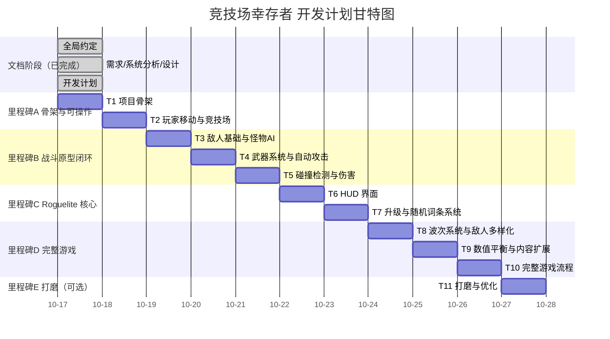

# 《竞技场幸存者》开发计划文档

| 项目 | 内容 |
|---|---|
| 文档编号 | 04 |
| 版本 | v1.0 |
| 依据 | docs/01_需求分析.md v1.0、docs/02_系统分析.md v1.0、docs/03_系统设计.md v1.0 |
| 文档性质 | 课程大作业 · 开发计划（子任务拆解，小步交付的依据） |

---

## 1. 拆解原则

1. **逻辑独立**：每个子任务只动一个功能域，不跨域大改；
2. **颗粒度适中**：每任务 3~5 个内部步骤，一次人工验收可聚焦；
3. **可人工验证**：每任务给出明确 Definition of Done 与验收要点；
4. **依赖排序**：严格串行推进；每个子任务交付后 **git 提交一次**；
5. **只增不改**：新内容走新文件，已验收文件除明确列出外不修改。

---

## 2. 依赖顺序总览

### 2.1 mermaid 甘特图（示意排期，一任务一步骤，串行交付）

### 2.2 任务一览表

| 任务 | 内容 | 里程碑 | 关键依赖 | 报告素材价值 |
|---|---|---|---|---|
| T1 | 项目骨架、窗口、主循环 | A 骨架 | — | 环境自主搭建（PPT 对比点） |
| T2 | 玩家移动、竞技场边界 | A | T1 | 基础玩法可演示 |
| T3 | Enemy 基类 + 爬行者 AI + 出生规则 | B 战斗原型 | T2 | 怪物 AI 难点·其一 |
| T4 | Weapon 基类 + 手枪 + 子弹 + 索敌 | B | T3 | 自动战斗核心 |
| T5 | 碰撞检测与伤害、无敌帧、经验掉落 | B | T4 | 碰撞检测难点 |
| T6 | HUD 界面 | C Roguelite | T5 | 交互观感 |
| T7 | 经验升级三选一 + 随机词条 | C | T6 | 随机词条难点（核心） |
| T8 | 波次曲线 + 两种新敌人差异化 AI | D 完整游戏 | T7 | 敌人生成难点 + AI 亮点 |
| T9 | 霰弹枪/飞刃 + 词条扩充 + 平衡自检 | D | T8 | 数值平衡难点 |
| T10 | 主菜单/暂停/结算/重开 | D | T9 | 完整玩法闭环 |
| T11 | 空间哈希、震屏、粒子、音效（可选） | E 打磨 | T10 | 性能优化素材 |

---

## 3. 子任务明细

### T1 项目骨架：环境、窗口、主循环

- **目标**：完成 vcpkg + CMake + raylib 环境搭建，窗口与固定时间步主循环跑通，为后续一切开发铺底。
- **内部步骤**：
  1. 初始化 vcpkg（manifest 模式）与 CMakeLists.txt，安装 raylib；
  2. main.cpp 创建窗口（1280×720，等比缩放，Esc 退出）；
  3. GameEngine 空壳：固定时间步（1/60s，accumulator 模式）主循环 + 五状态枚举声明；
  4. 按设计文档建立 src/ 空文件骨架与 constants.h 初版；更新 README（编译运行步骤）。
- **涉及文件**：新增 vcpkg.json、CMakeLists.txt、src/main.cpp、src/game.h/.cpp、src/constants.h、README.md。
- **依赖**：无。
- **DoD**：一条命令配置+编译成功；窗口标题正确；Esc 可退出；无玩法代码混入。
- **验收要点**：编译命令可复现 → 打开窗口 → 标题正确 → Esc 退出。

### T2 玩家移动与竞技场

- **目标**：玩家八方向移动（对角归一化）、围墙边界限制、跟随摄像机。
- **内部步骤**：
  1. Player 类（位置/半径/移速，读 constants）；
  2. 输入处理：WASD+方向键，斜向归一化；
  3. Arena 边界钳制（含半径防嵌墙）+ 围墙/地面绘制；
  4. Camera2D 跟随玩家居中；Esc 退出保持可用。
- **涉及文件**：新增 src/player.h/.cpp、src/arena.h/.cpp；修改 src/game.h/.cpp（接入 Player 与摄像机）、src/constants.h。
- **依赖**：T1。
- **DoD**：八方向移动速度一致；贴墙被挡不嵌入；镜头跟随。
- **验收要点**：对角移动无加速感 → 四方贴墙均停住 → 转大圈镜头平滑跟随。

### T3 敌人基础与怪物 AI

- **目标**：Enemy 基类 + 爬行者追踪 AI（含分离力）+ 出生规则，完成第一个可观察的 AI。
- **内部步骤**：
  1. Enemy 抽象基类（通用状态、takeDamage、update 框架）；
  2. 爬行者子类：追踪 + 同族分离力；
  3. EnemySpawner 临时版：F1 按键刷 10 只，边缘出生、距玩家 ≥400px；
  4. 临时调试显示：屏幕左上角显示场上敌人数。
- **涉及文件**：新增 src/enemy.h/.cpp、src/enemy_crawler.h/.cpp、src/enemy_spawner.h/.cpp；修改 src/game.h/.cpp、src/constants.h。
- **依赖**：T2。
- **DoD**：F1 刷怪；追踪玩家；群聚时保持分散；出生点合法。
- **验收要点**：刷怪点不在玩家脸上 → 敌人持续追击 → 大量敌人不叠成一点 → 计数值正确。

### T4 武器系统与自动攻击

- **目标**：Weapon 基类（索敌+冷却暂不实现工厂，仅手枪）+ 子弹 + 最近敌人索敌。
- **内部步骤**：
  1. Weapon 基类：索敌（射程内最近）、fireTimer 冷却；
  2. Pistol 子类：覆写 fire 单发；
  3. Projectile：飞行、射程衰减消失；
  4. Player 持有武器列表；GameContext 提供敌人遍历。
- **涉及文件**：新增 src/weapon.h/.cpp、src/weapon_pistol.h/.cpp、src/projectile.h/.cpp；修改 src/player.h/.cpp、src/game.h/.cpp。
- **依赖**：T3。
- **DoD**：F1 刷怪后自动对最近敌人开火；无目标不开火；子弹超射程消失。
- **验收要点**：站定不操作可见自动射击 → 目标死亡立即换目标 → 无敌人时无弹 → 子弹不无限飞行。

### T5 碰撞检测与伤害

- **目标**：圆-圆碰撞工具与三类检测的朴素版（伤害结算、击杀、经验点、无敌帧、击退）。
- **内部步骤**：
  1. collision.h 圆-圆检测工具函数（免开方）；
  2. 子弹-敌人：takeDamage → 击杀移除 + XPOrb 生成；
  3. 敌人-玩家：接触伤害 + 攻击冷却 + 0.6s 无敌帧（闪烁）+ 击退；
  4. HP 归零临时处理（锁 0 + 调试文字，正式死亡留 T10）。
- **涉及文件**：新增 src/collision.h/.cpp、src/xp_orb.h/.cpp；修改 src/enemy.h/.cpp、src/player.h/.cpp、src/projectile.h/.cpp、src/game.h/.cpp、src/constants.h。
- **依赖**：T4。
- **DoD**：手枪能击杀敌人；经验点掉落可见；玩家受击掉血/闪无敌/被击退且不连续掉血。
- **验收要点**：单次子弹恰对应一次伤害（按常量核对）→ 被围殴时掉血频率符合攻击冷却 → HP 归零不崩溃。

### T6 HUD 界面

- **目标**：进行中游戏的 HUD 显示。
- **内部步骤**：
  1. UI 层雏形（屏幕空间绘制，不随镜头）；
  2. 经验条+等级、血条（平滑过渡）、波次/倒计时占位、击杀数、武器说明；
  3. 中文显示方案（乱码则先英文并登记待办）。
- **涉及文件**：新增 src/ui.h/.cpp；修改 src/game.h/.cpp、src/main.cpp（装配 UI）。
- **依赖**：T5。
- **DoD**：各项数值实时刷新且随游戏状态变化。
- **验收要点**：击杀后击杀数+1 → 受伤血条平滑下降 → HUD 不随镜头晃动。

### T7 经验、升级三选一与随机词条系统（核心难点）

- **目标**：经验吸取、升级暂停三选一、Stats 属性中心与词条"修改 Stats"机制、装备词条结构就绪。
- **内部步骤**：
  1. Stats：倍率/加算字段全集 + 修改接口；
  2. 经验吸取（拾取半径）+ 升级阈值 + 溢出保留；
  3. UPGRADE 状态（实体全冻结）+ 三选一面板（1/2/3 选择、稀有度配色）；
  4. AffixLibrary：11 词条按权重抽取不重复；属性词条写 Stats；装备词条占位（T9 生效）；
  5. 每秒 hpRegen 结算。
- **涉及文件**：新增 src/upgrade_system.h/.cpp、src/affix_library.h/.cpp、src/stats.h/.cpp；修改 src/player.*、src/weapon.*（读 Stats 算伤害）、src/ui.*、src/game.*。
- **依赖**：T6。
- **DoD**：吸经验 → 升级弹 3 选项 → 选择后手感/数值可感知变化；状态冻结正确。
- **验收要点**：升级瞬间敌人与子弹静止 → 选移速后明显变快 → 选伤害后击杀所需子弹数减少 → 装备词条按钮存在但提示"即将开放"。

### T8 波次系统完整化与敌人多样化

- **目标**：正式波次流程（曲线/休整/构成权重）+ 喷吐者、蛮牛差异化 AI。
- **内部步骤**：
  1. WaveManager 状态机（WAITING→SPAWNING(分批)→FIGHTING→清场）；
  2. 数量曲线与生命倍率、构成权重接入 EnemySpawner；
  3. Spitter：放风筝 AI + 慢速敌弹（阵营标志）；
  4. Brute：蓄力(变色预警)→冲锋→冷却 状态机；
  5. F1 降级为调试用。
- **涉及文件**：新增 src/wave_manager.h/.cpp、src/enemy_spitter.h/.cpp、src/enemy_brute.h/.cpp；修改 src/enemy_spawner.*、src/projectile.*、src/game.*、src/constants.h。
- **依赖**：T7。
- **DoD**：从第 1 波自动开始完整波次循环；第 5 波现喷吐者、第 8 波现蛮牛。
- **验收要点**：波间 3 秒倒计时 → 刷怪分批不过卡 → 敌弹可被走位躲开 → 蛮牛冲锋前有明显预警 → 清场后正确进入下一波。

### T9 数值平衡与内容扩展

- **目标**：霰弹枪与环绕飞刃上线（验证"只加子类"设计）、词条池扩至 16+、平衡自查调参。
- **内部步骤**：
  1. Shotgun（扇形散射）+ OrbitalBlade（更新刃体与周期接触伤害）；
  2. 武器工厂注册机制 + 装备词条真正生效（获得/强化）；
  3. 词条池扩充（含条件词条：穿透、吸血）；
  4. 平衡自查：第 5/10 波实测 → docs/05_平衡性说明.md（调参+理由）。
- **涉及文件**：新增 src/weapon_shotgun.*、src/weapon_orbital.*、docs/05_平衡性说明.md；修改 src/weapon.*（工厂）、src/affix_library.*、src/constants.h、docs/03 数值表（同步）。
- **依赖**：T8。
- **DoD**：两把新武器经升级可获且手感区分明显；词条文案与效果一致；平衡文档产出。
- **验收要点**：选霰弹后贴脸清怪快于手枪但射程短 → 飞刃近身自动出伤 → 连续多局构筑出现差异 → 无"一招毁平衡"的组合。

### T10 完整游戏流程

- **目标**：主菜单、暂停、死亡结算与重新开始，形成可完整游玩的闭环。
- **内部步骤**：
  1. 主菜单（开始/退出，开局重置）；
  2. 暂停菜单（Esc 切换，继续/回菜单/退出）；
  3. 死亡→GAME_OVER→本局统计（波次/击杀/等级/时长）→重开/回菜单；
  4. resetGame 全量重置自查（无残留）。
- **涉及文件**：修改 src/game.*、src/ui.*、src/main.cpp、README.md。
- **依赖**：T9。
- **DoD**：菜单→多波战斗→死亡结算→重开 完整闭环无残留、无卡死。
- **验收要点**：重开后波次/等级/武器/击杀全部归初始 → 状态来回切换循环 3 次不崩 → 结算数字与本局经历一致。

### T11 打磨与优化（可选）

- **目标**：空间哈希碰撞替换 + 打击感表现 + 可选音效。
- **内部步骤**：
  1. CollisionSystem 空间哈希（两版可切换，日志对比帧率）；
  2. 受击闪白、命中粒子、击杀飘字、震屏；
  3. 程序生成音效（射击/命中/升级/死亡）；
  4. README 完善（含截图占位）。
- **涉及文件**：修改 src/collision.*、src/game.*、src/ui.*；新增 assets/（可选）。
- **依赖**：T10。
- **DoD**：200+ 敌人同屏 60 FPS 且行为与朴素版一致；表现可感知。
- **验收要点**：同屏高敌数帧率稳定 → 两版切换行为一致性抽测 → 音效开关不影响逻辑。

---

## 4. 里程碑与报告对应

| 里程碑 | 任务 | 完成后项目状态 | 建议截图时机 |
|---|---|---|---|
| A 骨架 | T1~T2 | 可移动角色 + 竞技场 | 附录B #1~#4 |
| B 战斗原型 | T3~T5 | 刷怪→自动射击→击杀循环 | 附录B #4~#6 |
| C Roguelite 核心 | T6~T7 | 升级构筑成型 | 附录B #7~#9 |
| D 完整游戏 | T8~T10 | 可完整游玩 | 附录B #10~#13 |
| E 打磨 | T11 | 表现与性能完备（可选） | 附录B #14 |

## 5. 提交与验收规范

1. 每个子任务完成后：编译通过 → 自测 → **git 提交一次**（提交信息格式 `[T{n}] {任务名}`）→ 输出《验收清单》；
2. 验收清单必须包含：编译命令、运行方式、操作步骤、预期现象（≥3 条）;
3. 收到开发者反馈的问题后：只改问题相关代码，修复后重新输出针对性的复测清单;
4. 如某任务的实际实现与文档（01~03）冲突，先在回复中说明冲突点与修订意见，经确认后再改代码。

## 6. 变更记录

| 版本 | 日期 | 变更内容 |
|---|---|---|
| v1.0 | 2026-10-17 | 初版：T1~T11 拆解、依赖甘特图、DoD 与验收要点、里程碑规划 |